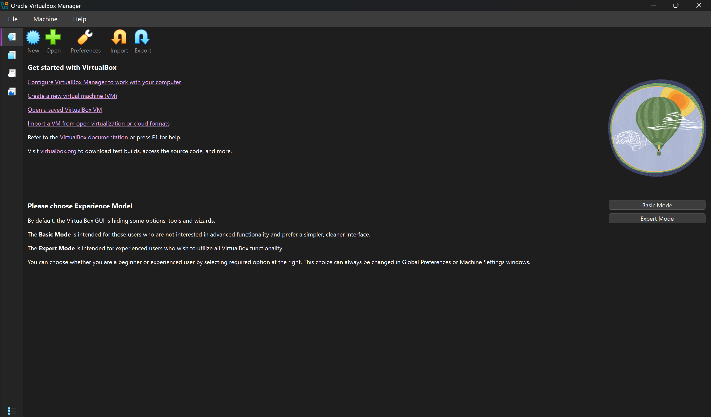
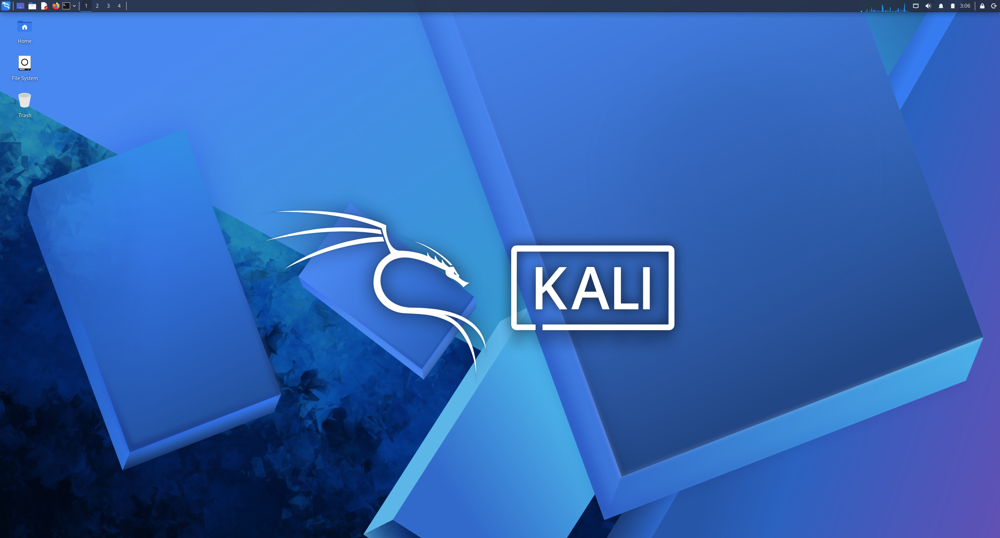
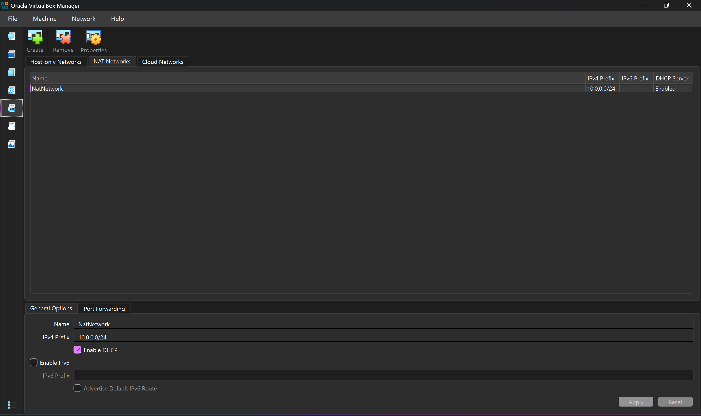
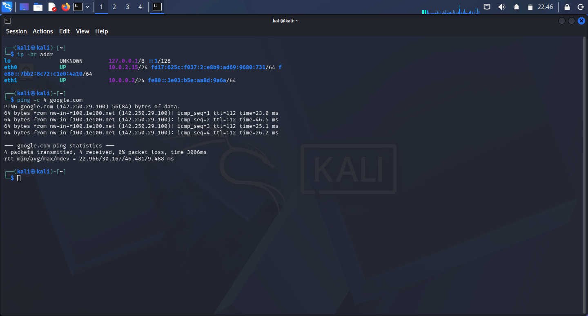
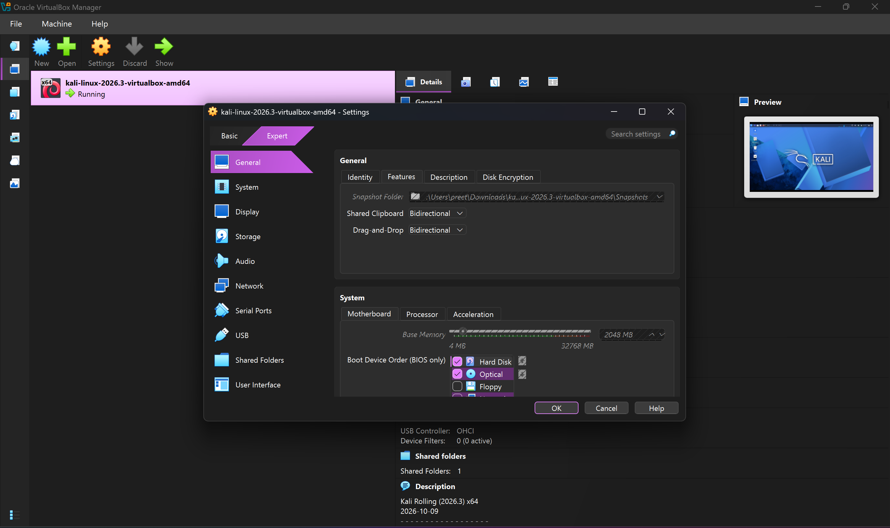
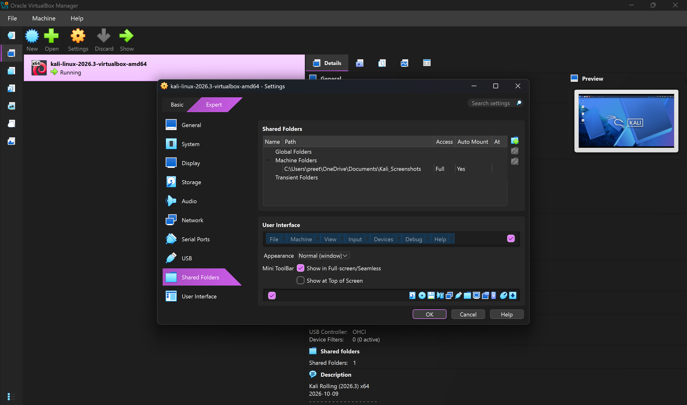

# Cybersecurity Lab Setup — Screenshot Evidence

## 1. VirtualBox Setup

## 2. Kali Linux Desktop

## 3. NAT Network Configuration

## 4. Static IP Configuration

## 5. Internet and DNS Connectivity

## 6. Virtual Machine Integration

## 7. Shared Folder

